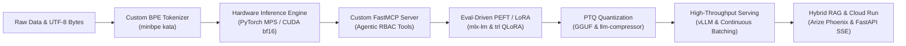

# Applied AI Foundry (`applied-ai-foundry`)

> **Enterprise AI Systems Engineering, Hardware-Accelerated LLM Inference, Custom MCP Tooling & Production MLOps.**

[%20%7C%20NVIDIA%20L4%20Ada-blue)](#hardware-matrix)
[](https://pytorch.org/)
[](https://huggingface.co/)
[](https://modelcontextprotocol.io/)
[](#deployment)

---

## Executive Summary

**`applied-ai-foundry`** is an intensive, production-grade AI systems engineering repository built by a 10-year software & infrastructure engineering veteran transitioning into **Forward Deployed Engineer (FDE)**, **Applied AI Architect**, and **Enterprise AI Solutions** roles.

Rather than relying on closed black-box APIs or unoptimized notebook wrappers ("vibe-coding"), this repository demonstrates end-to-end engineering across the open-weight LLM lifecycle:



---

## Core Pillars & 6-Week Engineering Curriculum

| Week | Engineering Domain | Primary Stack | Core Deliverable & Artifact |
| :--- | :--- | :--- | :--- |
| **Week 1** | **Tokenization & Inference Internals** | PyTorch MPS, `transformers` v5, BPE | Custom Byte-Level BPE tokenizer kata, `DynamicCache` memory telemetry, `Qwen3-4B` MPS benchmark |
| **Week 2** | **Constrained Decoding & Agent Protocols** | `FastMCP`, `outlines`, Pydantic v2 | Production MCP Server with RBAC boundaries, schema validation, and audit logging |
| **Week 3** | **Eval Harnesses & Local PEFT / LoRA** | Apple `mlx-lm`, `promptfoo`, `peft` | 100-item Golden Eval suite (LLM-as-a-Judge) + 4-bit LoRA fine-tuning on M4 Unified Memory |
| **Week 4** | **Cloud QLoRA, DPO/GRPO & Hub Publishing** | `bitsandbytes` NF4, `trl` v1+, HF Hub | Preference-aligned SFT adapter (`imhlg/...`) pushed to Hugging Face Hub with verifiable rewards |
| **Week 5** | **Post-Training Quantization & vLLM** | `llm-compressor`, `vLLM`, `llama.cpp` | W4A16/FP8 calibration, continuous batching benchmark, and **CTO GPU Sizing & TCO Model** |
| **Week 6** | **Hybrid Agentic RAG & Cloud Deployment** | `FastAPI`, Docker, OpenTelemetry, GCP | Multi-stage containerized microservice deployed to **GCP Cloud Run** with Phoenix LLMOps tracing |

---

## Hardware Matrix & Zero-Cost Cloud Discipline

- **Tier-0 Local Edge Compute**: Apple MacBook Air M4 (24GB Unified Memory) utilizing Metal Performance Shaders (`torch.backends.mps`), Apple `mlx-lm`, and local Metal `llama.cpp`.
- **Local Agent Server**: `Qwen3-Coder-30B-A3B` (`Q3_K_L` MoE GGUF, ~14.5GB VRAM) hosted in LM Studio (`http://localhost:1234/v1`).
- **Tier-1 Cloud Compute**: NVIDIA T4 & L4 GPUs (Ada SM 8.9) via Google Colab Pro utilized in targeted 20-minute execution bursts.
- **Production Hosting Plane**: Google Cloud Run (Always-Free CPU Tier) and Hugging Face Spaces (Free 16GB RAM) backed by Gemini API Free Tier.

---

## Repository Structure

```text
applied-ai-foundry/
├── AGENTS.md                          # Production agent rules & FDE pedagogy
├── LEARNING_PLAN.md                   # Living 150-hour mastery plan & daily progress
├── GROK_CAREER_AND_PROGRESS_SYNC.md   # Live FDE interview prep & role matching context
├── requirements.txt                   # Locked production dependencies
├── src/
│   ├── week1_bpe_kata.py              # Hand-written Byte-Level BPE from scratch (4/4 tests passed)
│   ├── week1_tokenizer_deep_dive.py   # Tokenization internals, reasoning tags & left-padding
│   └── week1_mps_starter.py           # Production MPS inference & DynamicCache telemetry
```

---

## Quickstart

### 1. Environment Setup
```bash
git clone https://github.com/imhlg/applied-ai-foundry.git
cd applied-ai-foundry

python3 -m venv .venv
source .venv/bin/activate
pip install -r requirements.txt
```

### 2. Verify Tokenizer & BPE Engine
```bash
python3 src/week1_bpe_kata.py
# Output:
# [PASS] 1/4 get_pair_counts() accurately counts adjacent pairs.
# [PASS] 2/4 merge_pair() handles non-overlapping left-to-right merges.
# [PASS] 3/4 train_bpe() learned 20 subword merges.
# [PASS] 4/4 Lossless UTF-8 Round-Trip verified (including unseen emoji 🚀🔥)!
# Corpus Compression: 202 raw UTF-8 bytes -> 148 BPE tokens (1.36x compression)
```

### 3. Run Hardware-Instrumented MPS Inference
```bash
python3 src/week1_mps_starter.py
```

---

## Author
- **Harnoor Singh** ([@imhlg](https://github.com/imhlg))
- **Hugging Face**: [huggingface.co/imhlg](https://huggingface.co/imhlg)
