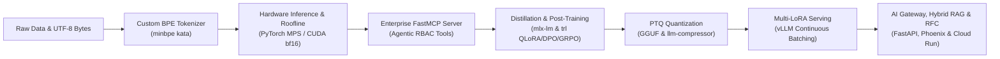

# Applied AI Foundry (`applied-ai-foundry`)

> **Enterprise AI Systems Engineering, Hardware-Accelerated LLM Inference, Custom MCP Tooling & Production MLOps.**

[%20%7C%20NVIDIA%20L4%20Ada-blue)](#hardware-matrix)
[](https://pytorch.org/)
[](https://huggingface.co/)
[](https://modelcontextprotocol.io/)
[](#deployment)

---

## Executive Summary

**`applied-ai-foundry`** is an intensive, production-grade **Enterprise AI Platform, Post-Training & High-Throughput Inference Systems** reference architecture built by a 10-year software, cloud infrastructure & technical program veteran targeting **Staff / Principal AI Platform TPM**, **Senior / Staff AI Platform & Inference Engineer**, **Lead Applied AI / Post-Training Engineer**, and **Forward Deployed Engineer (FDE) / Principal AI Solutions Architect** roles.

Rather than relying on closed black-box APIs or unoptimized notebook wrappers ("vibe-coding"), this repository demonstrates end-to-end engineering across the open-weight LLM & Enterprise AI Platform lifecycle:



---

## Core Pillars & 6-Week Engineering Curriculum (v4.0 — 252 Hours @ 42 hrs/wk)

| Week | Engineering Domain | Primary Stack | Core Deliverable & Venture Prototype |
| :--- | :--- | :--- | :--- |
| **Week 1** | **Tokenization, Weight Matrices ($W_q, W_{mlp}$), SVD & QLoRA** | PyTorch MPS/CUDA, `transformers` v5, `TRL`, SVD | Byte-Level BPE kata (`4/4` tests), SVD weight spectrum analysis, 4-bit NF4 QLoRA & $\Delta W = B \cdot A$ trajectory inspection |
| **Week 2** | **Residual Streams, Runtime Activation Steering & Probes** | PyTorch Forward Hooks, `Outlines`, Linear Probes | **Prototype 1**: Runtime activation probe & steering engine (`<2ms` latency overhead vs. `>500ms` prompt guardrails) |
| **Week 3** | **MoE Router Profiling, Expert Pruning & Distillation** | `OLMoE-1B-7B` / `Qwen2.5-MoE`, MSAN, `TRL`, `vLLM` | **Prototype 2**: Automated MoE expert surgery & 1-epoch distillation recovery (`-35%` VRAM, `<1.5%` accuracy drop) |
| **Week 4** | **Machine Unlearning (NPO/ROME), `vLLM` & Thesis Lock** | `TRL` (NPO), ROME, `vLLM` PagedAttention, `httpx` | **Prototype 3**: Surgical PII erasure (`0%` forget-set recall, `>99%` accuracy) + **Sunday Tournament Lock** |
| **Week 5** | **Productize Winning Thesis, Open-Source Wedge & FinOps** | Python CLI / `vLLM` Plugin, GitHub Actions, `curons.org` | Reproducible open-source package + FinOps TCO Calculator + `curons.org` B2B Audit Pilot Offer (\$3k–\$5k) |
| **Week 6** | **Production Cloud Serving, Staff RFC & B2B Outbound** | Docker, AWS EC2 (`g5.xlarge`) / Cloud Run, HF Spaces | Live production endpoint + **2-Page Staff AI Platform Architecture RFC** + 30 personalized B2B teardowns |

---

## Hardware Matrix & Zero-Cost Cloud Discipline

- **Tier-0 Local Edge Compute**: Apple MacBook Air M4 (24GB Unified Memory) utilizing Metal Performance Shaders (`torch.backends.mps`), Apple `mlx-lm`, and local Metal `llama.cpp`.
- **Local Agent Server**: `Qwen3-Coder-30B-A3B` (`Q3_K_L` MoE GGUF, ~14.5GB VRAM) hosted in LM Studio (`http://localhost:1234/v1`).
- **Tier-1 Cloud Compute**: NVIDIA T4 & L4 GPUs (Ada SM 8.9) via Google Colab Pro utilized in targeted 20-minute execution bursts.
- **Production Hosting Plane**: Google Cloud Run (Always-Free CPU Tier) and Hugging Face Spaces (Free 16GB RAM) backed by Gemini API Free Tier.

---

## Repository Structure

```text
applied-ai-foundry/
├── AGENTS.md                          # Workspace agent rules & top-down FDE pedagogy
├── CLAUDE.md                          # Claude Code CLI (`claude`) project memory & rules
├── LEARNING_PLAN.md                   # Living 150-hour mastery plan & daily progress
├── GROK_CAREER_AND_PROGRESS_SYNC.md   # Live FDE interview prep & role matching context
├── requirements.txt                   # Locked production dependencies
├── src/
│   ├── week1_bpe_kata.py              # Hand-written Byte-Level BPE from scratch (4/4 tests passed)
│   ├── week1_tokenizer_deep_dive.py   # Tokenization internals, reasoning tags & left-padding
│   └── week1_mps_starter.py           # Production MPS inference & DynamicCache telemetry
```

---

## Quickstart

### 1. Environment Setup
```bash
git clone https://github.com/garg-achal/applied-ai-foundry.git
cd applied-ai-foundry

python3 -m venv .venv
source .venv/bin/activate
pip install -r requirements.txt
```

### 2. Verify Tokenizer & BPE Engine
```bash
python3 src/week1_bpe_kata.py
# Output:
# [PASS] 1/4 get_pair_counts() accurately counts adjacent pairs.
# [PASS] 2/4 merge_pair() handles non-overlapping left-to-right merges.
# [PASS] 3/4 train_bpe() learned 20 subword merges.
# [PASS] 4/4 Lossless UTF-8 Round-Trip verified (including unseen emoji 🚀🔥)!
# Corpus Compression: 202 raw UTF-8 bytes -> 148 BPE tokens (1.36x compression)
```

### 3. Run Hardware-Instrumented MPS Inference
```bash
python3 src/week1_mps_starter.py
```

---

## Author
- **Achal Garg** ([@garg-achal](https://github.com/garg-achal))
- **Hugging Face**: [huggingface.co/garg-achal](https://huggingface.co/garg-achal)

## Week 1 – MPS Inference Benchmark Results

- **Model**: `Qwen/Qwen3-4B` (4 B parameters)
- **Device**: Apple M4 (MPS backend) – dtype `torch.bfloat16`
- **Load time**: **4.63 seconds**
- **Metal driver memory** after load: **7.50 GB**
- **Input tokens**: 73
- **Generated tokens**: 129 in **12.30 seconds** → **10.5 tokens/sec**
- **KV‑Cache sequence length**: 201 (73 input + 128 generated)
- **Metal driver memory after inference**: **7.63 GB** (≈ 0.13 GB for KV‑Cache)

*Takeaways*: loading fits comfortably in unified memory, bfloat16 saves bandwidth, KV‑Cache is tiny (~30 MB for 201 tokens), throughput ~10 tok/s is memory-bandwidth-bound on M4.
